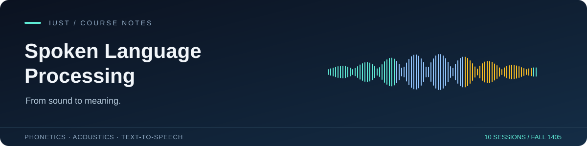

<p align="center"></p>

<p align="center"><strong>English</strong> · <a href="README.fa.md">فارسی</a></p>

# Spoken Language Processing · IUST

A Persian study companion for the **Spoken Language Processing** course at **Iran University of Science and Technology**, taught by **Dr. Zeynab Aghahadi (دکتر زینب آقاهادی)** in **Fall 1405**. Ten sessions connect the physics of speech with modern text-to-speech systems.

<p align="center">
  <a href="slp-booklet/releases/speech-processing-booklet-fa-draft.pdf"><strong>Read the complete booklet ↗</strong></a>
  &nbsp; · &nbsp;
  <a href="#session-notes">Browse session notes</a>
  &nbsp; · &nbsp;
  <a href="slp-booklet/latex/main.tex">Explore the LaTeX source</a>
</p>

## The reading desk

| Resource | What you’ll find | Access |
| :--- | :--- | :--- |
| **Complete booklet** | Illustrated Persian booklet covering sessions 1–10; current draft | [View PDF](slp-booklet/releases/speech-processing-booklet-fa-draft.pdf) · [Download PDF](slp-booklet/releases/speech-processing-booklet-fa-draft.pdf?raw=true) |
| **Summarized booklet** | A shorter companion for review | **Coming soon** — will be linked here when added |
| **Session notes** | Ten individual Markdown documents | [Browse notes](notes/) |
| **ChatGPT versions** | Shared classroom-note conversations for each session | [Session index below](#session-notes) |

The complete booklet brings together definitions, worked examples, diagrams, practical exercises, and instructor remarks. It is a study draft covering the first ten sessions, with additional explanations marked in the text.

## Session notes

Each session has a local Markdown copy and a shared ChatGPT conversation.

| Session | Topic | Notes | ChatGPT |
| :---: | :--- | :---: | :---: |
| 01 | Introduction & downstream tasks | [Read](notes/01.md) | [Open conversation](https://chatgpt.com/share/6ae3359d-0d58-83ed-b2d7-886c1f2f5959) |
| 02 | Language sciences & articulatory phonetics | [Read](notes/02.md) | [Open conversation](https://chatgpt.com/share/6ae3358e-89c8-83ed-8584-428f34791231) |
| 03 | Acoustic phonetics & spectrograms | [Read](notes/03.md) | [Open conversation](https://chatgpt.com/share/6ae33582-29c8-83ed-aa88-6c4254583b4f) |
| 04 | Formants, Praat & vowel space | [Read](notes/04.md) | [Open conversation](https://chatgpt.com/share/6ae33573-b460-83ed-a93d-fe81f645f69b) |
| 05 | Mel scale & MFCCs | [Read](notes/05.md) | [Open conversation](https://chatgpt.com/share/6ae33561-63dc-83ed-bcb6-6c4c29c3de3f) |
| 06 | Prosody | [Read](notes/06.md) | [Open conversation](https://chatgpt.com/share/6ae3354b-85f4-83ed-962c-96d42dec7040) |
| 07 | The text-to-speech pipeline | [Read](notes/07.md) | [Open conversation](https://chatgpt.com/share/6ae3353f-903c-83eb-b6eb-ac044dd4eb25) |
| 08 | Neural networks & text representations | [Read](notes/08.md) | [Open conversation](https://chatgpt.com/share/6ae33533-7080-83eb-b9bc-909b6cbfe4dc) |
| 09 | Contextual embeddings & grapheme-to-phoneme conversion | [Read](notes/09.md) | [Open conversation](https://chatgpt.com/share/6ae33522-7fb4-83ed-af9a-2958e00724fa) |
| 10 | Positional encoding | [Read](notes/10.md) | [Open conversation](https://chatgpt.com/share/6ae3350b-249c-83ed-92ba-1a27ae3254c2) |

## Build the booklet

The compiled PDF is ready to read. To edit and rebuild it, install **TeX Live or MacTeX** with **XeLaTeX**, **latexmk**, and the packages used in [main.tex](slp-booklet/latex/main.tex), including `xepersian`. The source’s fonts and figures are included.

```bash
git clone git@github.com:AmirHosseinCV/slp-iust.git
cd slp-iust/slp-booklet
make
```

The build produces `build/main.pdf` and updates [`releases/speech-processing-booklet-fa-draft.pdf`](slp-booklet/releases/speech-processing-booklet-fa-draft.pdf). See the [booklet guide](slp-booklet/README.md) for individual chapter builds.

## Repository map

```text
.
├── README.md                English guide
├── README.fa.md             راهنمای فارسی
├── docs/                    README artwork
├── notes/                   Session notes: 01.md … 10.md
└── slp-booklet/
    ├── assets/              Fonts and booklet figures
    ├── latex/               Main document and ten chapters
    ├── releases/            Compiled booklet PDF
    └── Makefile             Build and release commands
```

## Corrections & acknowledgments

Course instruction is credited to **دکتر زینب آقاهادی**. This repository collects study materials, including ChatGPT versions of classroom notes. Corrections are welcome through [issues](https://github.com/AmirHosseinCV/slp-iust/issues) or pull requests; please include the session or page and your suggested correction.
